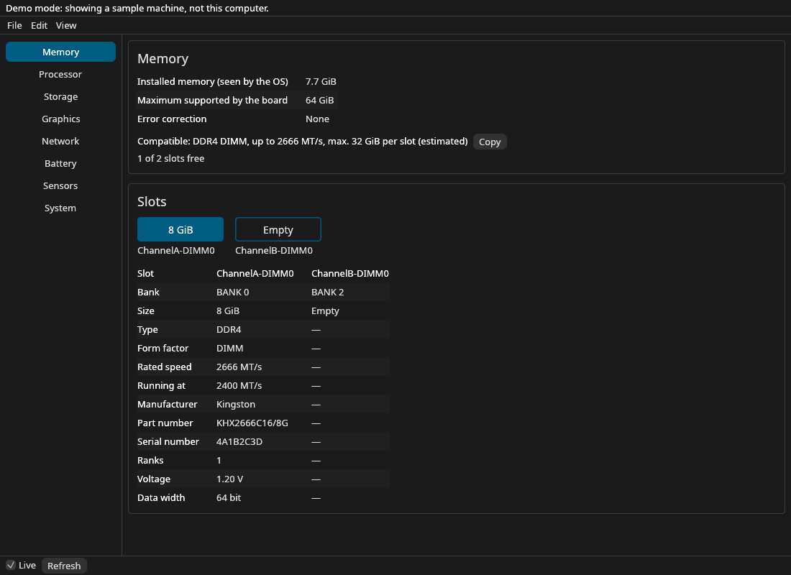
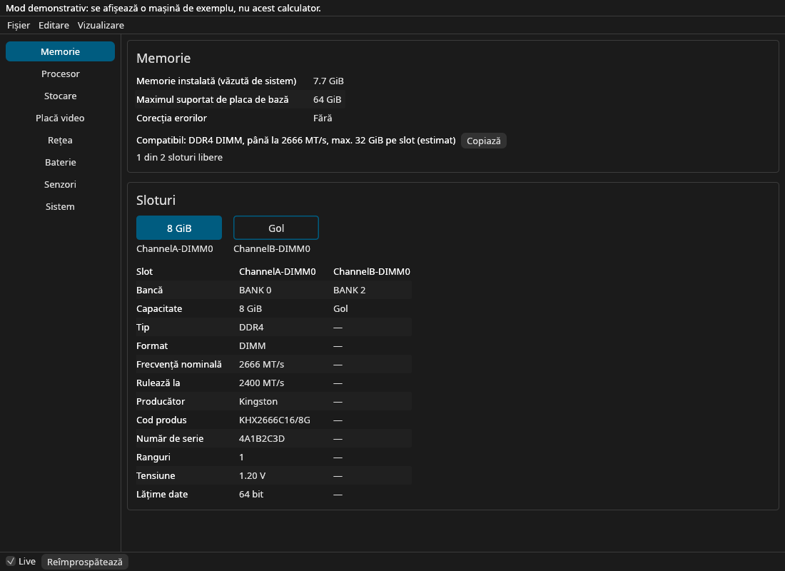
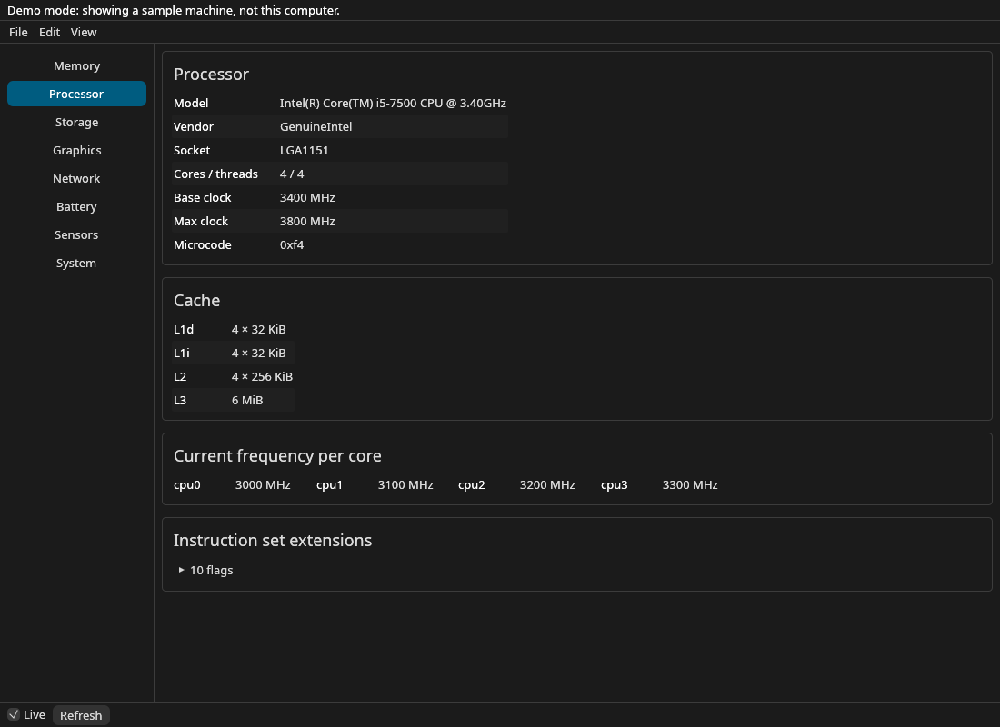
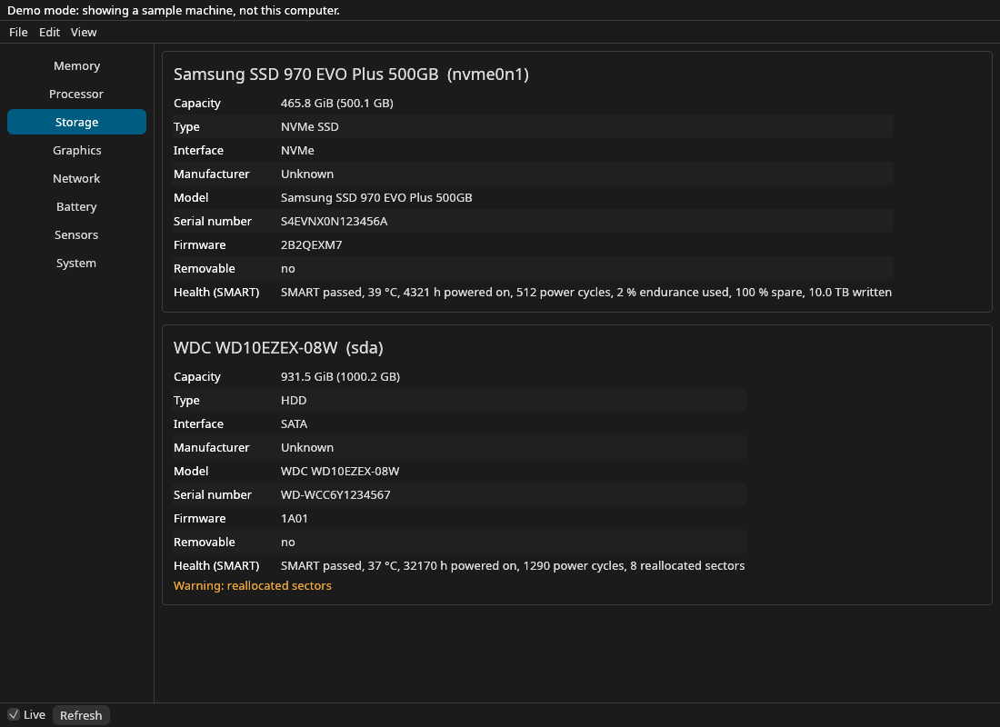
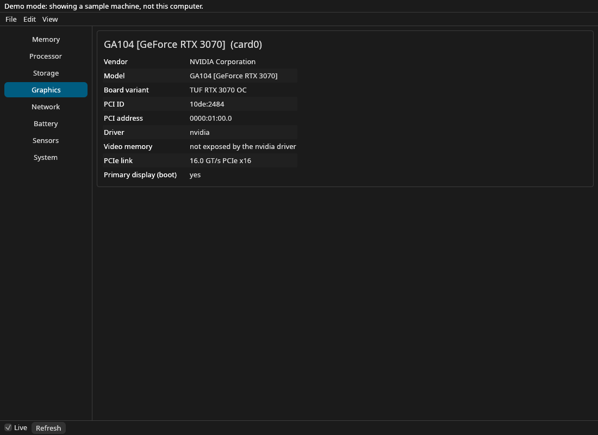
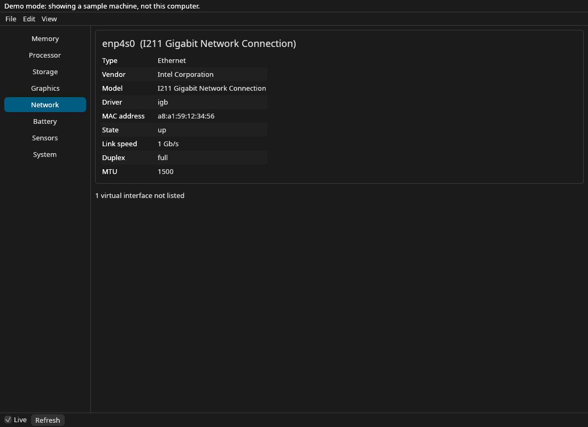
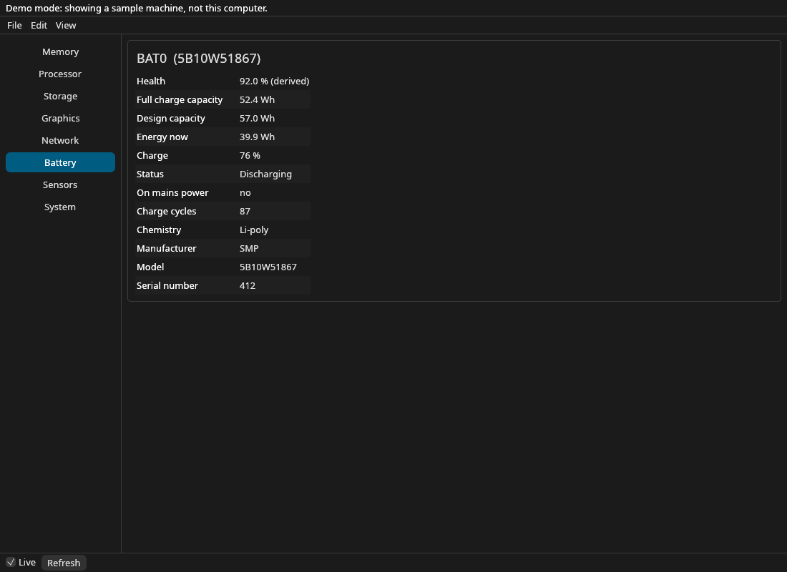
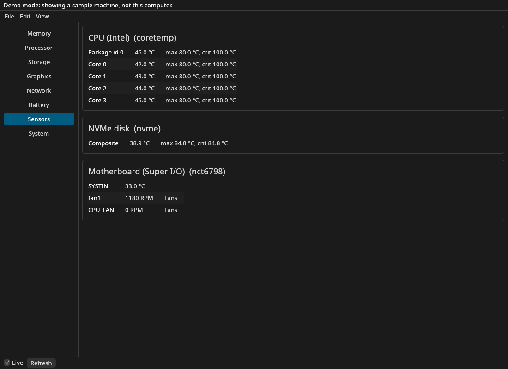

<div align="center">

<p align="center">
  
</p>


**A desktop app for Linux and Windows that shows your computer's hardware in detail: every RAM slot, the CPU, disks with their SMART health, graphics, network, battery and sensors, without opening a terminal.**

[](https://github.com/nazdravan/rigscope/actions/workflows/ci.yml)
[](#license)
[](Cargo.toml)
[](https://github.com/emilk/egui)
[](#linux)
[](#windows)

[Quick start](#quick-start) · [Memory](#memory) · [Processor](#processor) · [Storage](#storage-and-smart) · [Privileges](#root-and-privileges) · [Windows](#windows) · [Releases](../../releases) · [Issues](../../issues)

**English** · [Română](README.ro.md)

</div>

<br />

On Linux the details are spread over `lshw`, `dmidecode`, `inxi`, `smartctl` and `/sys`, and most
of them print raw text. rigscope gathers them in one window, in English or Romanian, and answers
the question that usually starts the search: *which RAM can I buy for this machine?*



> **Note: tested on real hardware on Windows, not yet on Linux.** Windows ran on a real laptop
> (i7-4600U, Windows 10 22H2) on 2026-11-05; the values matched Task Manager and WMI. The Linux
> build was built and tested inside Docker (with synthetic hardware data) and on macOS: the
> privilege prompt (`pkexec`), SMART on real disks, the clipboard and the file dialogs still need
> a check on a real Linux machine.

## Quick start

There is no release yet: packages (AppImage, `.deb`, `.tar.gz` for Linux, a portable `.exe` for
Windows) come with the first version. Until then, build it from source.

### From source

```sh
# Rust from https://rustup.rs, then:
git clone https://github.com/nazdravan/rigscope.git
cd rigscope
cargo run --release -p rigscope
```

The binary lands in `target/release/rigscope`. On Linux, Windows and macOS it reads your
machine; elsewhere it opens a sample machine in demo mode. Useful flags:

```sh
rigscope --lang ro                 # Romanian interface
rigscope --section storage         # open a section directly
rigscope --fixture fixtures/laptop-ddr5   # show a sample machine instead of this one
rigscope --capture-fixture DIR     # Windows, elevated: save a masked fixture of this machine
```

Linux runtime extras (optional): `pkexec` (polkit) for slot details and SMART, `smartmontools` for
disk health, `hwdata` (`pci.ids`) for graphics and network card names.

---

## What it shows

| Section | What you get |
|---|---|
| **Memory** | Every slot: maker, part number, serial, size, rated vs running speed, ranks, voltage, width; empty slots; board maximum; a compatibility line to paste into a shop search |
| **Processor** | Model, socket(s), cores / threads, base and max clock, live clock per core (on Windows estimated as % Processor Performance × base clock), L1–L3 caches, microcode, instruction set extensions |
| **Storage** | NVMe / SATA / USB / virtio disks (on Windows from WMI, with SMART for NVMe and SATA): model, capacity (GiB and GB), SSD or HDD, bus, firmware, serial, SMART health with warnings |
| **Graphics** | Each card: vendor, model and board variant (from `pci.ids`), driver, PCIe link, video memory where the driver exposes it (on Windows exact VRAM from DXGI, the PCIe link and the temperature through D3DKMT) |
| **Network** | Physical interfaces: Ethernet or Wi-Fi, adapter name, driver, MAC, state, speed, duplex, MTU (virtual ones are counted, not listed) |
| **Battery** | Health (full vs design capacity, derived), energy now, charge, cycles, chemistry, mains state |
| **Sensors** | Temperatures with their limits and fan speeds from `hwmon`, updated every second. On Windows the GPU temperature (D3DKMT) and the ACPI thermal zones, labelled as such: never shown as the CPU temperature |
| **System** | Distribution, kernel, hostname, uptime, motherboard and BIOS |
| **Export** | Copy or save a text report, save or open a JSON snapshot; serial numbers, MACs and the hostname are masked by default |

Values the hardware does not report are shown as *Unknown*, values that need root as *Needs
root*, and derived values are marked *(estimated)* or *(derived)*: nothing is guessed.

## Memory

The compatibility line sums up what fits: type and form factor, the highest rated speed of the
installed modules, the board's maximum divided by its slots (*estimated*: SMBIOS has no
per-slot limit), and how many slots are free. **Copy** puts `DDR4 DIMM 2666 MT/s 32GB` on the
clipboard. Mixed memory types and soldered memory are called out instead of producing a wrong
line.



## Processor

Live clock per core (from cpufreq, or from `/proc/cpuinfo` when cpufreq is missing, marked as
such), caches grouped by size so hybrid P/E-core CPUs show both kinds, and the socket count on
multi-socket machines.



## Storage and SMART

Disks come from `/sys/block`; the bus is read from the device path, so USB sticks and virtual
disks are not mistaken for SATA. SMART needs root: **Read with elevated rights** runs
`smartctl --json -a` through the privileged helper and shows the verdict, temperature, power-on
hours, NVMe wear and data written, and ATA reallocated / pending / uncorrectable sectors, with
warnings.



<table>
<tr>
<td></td>
<td></td>
</tr>
<tr>
<td></td>
<td></td>
</tr>
</table>

## Keyboard shortcuts

<!-- shortcuts:start -->
| Shortcut | Action |
|---|---|
| `Ctrl+L` | Live updates |
| `Ctrl+O` | Open snapshot… |
| `Ctrl+S` | Save snapshot… |
| `Ctrl+Shift+C` | Copy report |
| `Ctrl+Z` | Undo |
| `F5` | Refresh |
<!-- shortcuts:end -->

---

## Root and privileges

The window never runs as root. Everything readable by a normal user is read directly; the BIOS
memory table (`/sys/firmware/dmi/tables/DMI`) and SMART are root-only. For those, **Read with
elevated rights** starts `pkexec /bin/sh -c <script>`: one password prompt, and the script, built
into rigscope, only prints the two DMI files and runs `smartctl` from a fixed system path, with
fixed arguments, for validated disk names. No file of rigscope runs as root, so there is nothing
to install and it works the same from the AppImage, the `.tar.gz` or the `.deb`. The script
parses nothing; the unprivileged window parses the result. The window stays responsive while the
password prompt is open.

On Windows the whole app runs as administrator (the manifest asks for it at each start), so there
is no separate elevated read.

## Decisions

- **No guessing.** A BIOS that reports nonsense is shown as it is; missing values say why.
- **Per-slot maximum is an estimate.** SMBIOS gives only the board total; the line says so.
- **USB, virtio and MMC disks get no SSD/HDD label**: their `rotational` flag is unreliable.
- **Virtual network interfaces are counted, not listed**, so Docker bridges do not bury the NIC.
- **Video memory for the proprietary NVIDIA driver is not shown**: it is not in sysfs.

## Snapshot file

**File → Save snapshot** writes JSON (`"schema": 1`, serials masked unless you choose
otherwise). **Open snapshot** shows a saved file instead of this machine; live updates stop until
**Refresh** returns to this computer. Files up to 4 MiB are accepted; older files without the
newer sections still open.

## Linux

Needs a desktop with X11 or Wayland. Reads `/proc`, `/sys` and `/etc/os-release`; optional:
polkit (`pkexec`), `smartmontools`, `hwdata`. Tested in Debian 12 (Docker, Xvfb).
**Note: not yet run on a real Linux machine.**

## Windows

Once a release exists, download `rigscope-<version>-windows-x86_64.exe` from the
[releases](../../releases). It is portable: nothing is installed, and it is an x86_64 MSVC build with a static CRT. The minimum is
Windows 10 1809; on older builds the PCIe link and the GPU temperature show as unavailable.

- **A UAC prompt at every start.** The `.exe` asks for administrator rights because SMART and the
  disk IOCTLs need them. The whole app runs elevated (there is no separate helper).
- **SmartScreen warns** ("Windows protected your PC"): the `.exe` is not code-signed. Click
  **More info** → **Run anyway**, and check the file against `SHA256SUMS.txt` from the release:
  `Get-FileHash rigscope-<version>-windows-x86_64.exe`.
- **What it reads:** memory slots from the firmware SMBIOS table (no elevation needed), CPU
  topology and caches, a live clock estimated as % Processor Performance × base clock, disks from
  WMI with SMART for NVMe and SATA (also behind Intel RST/RAID when the controller passes ATA
  SMART through), graphics with exact VRAM (DXGI), the PCIe link and the temperature through
  D3DKMT on WDDM 2.4+, network and battery. ACPI thermal zones appear as "ACPI thermal zone",
  never as the CPU temperature.
- **What it cannot read:** the CPU temperature and the fans. Both need a kernel driver, and
  rigscope installs no drivers.
- **Tested on real hardware** on 2026-11-05: an i7-4600U laptop with Windows 10 22H2. Memory,
  cores / threads, caches, disk, graphics, network and battery matched Task Manager and WMI.

For contributors: `rigscope --capture-fixture DIR` (Windows, elevated) saves a masked fixture of
the machine, and `--fixture DIR` opens either kind of fixture on any OS. The release `.exe` has
no console window, so the capture's result (success or the error) is in `DIR/capture.log`. Fixture names do not
contain `:` (encoded as `%3A`) and symlinks are listed in `links.txt`; `.gitattributes` forces LF.

## macOS and others

**macOS** reads the machine through `system_profiler` and `sysctl`: memory modules (size, type,
speed, maker, part number), processor, board model and operating system. Storage, Graphics,
Network, Battery and Sensors are not read there yet and show Unknown. macOS reports only the speed
a module runs at, not its rated speed, voltage or ranks, and Apple silicon has no slots, so only
the total is shown. Tested on one Intel iMac (macOS 13); the Apple silicon path is covered by
tests only. `rigscope --capture-fixture DIR` saves a masked fixture of the Mac.

Anything else builds and runs for development, in demo mode with a sample machine.

---

## Code structure

| Path | What it holds |
|---|---|
| `crates/rigscope-model` | The snapshot: plain data + serde, compatibility line, text report, masking |
| `crates/rigscope-smbios` | Panic-free SMBIOS/DMI decoder (types 0, 2, 4, 16, 17) |
| `crates/rigscope-procfs` | Parsers for `/proc` and `/sys` text, `pci.ids` lookup |
| `crates/rigscope-win`, `crates/rigscope-probe-win` | Windows: the unsafe Win32 FFI layer (its calls compile on Windows only) and the collector built on it; both crates build and run their tests on every OS |
| `crates/rigscope-probe` | Builds a snapshot from a `Source` (real fs, fixture dir, memory); disks, GPUs, network, battery, sensors, smartctl JSON |
| `crates/rigscope-engine` | Session, command registry, undo, panic guard |
| `crates/rigscope-ui` | egui panels, English/Romanian strings, theme |
| `apps/rigscope` | The binary: window, privileged helper, control channel |
| `xtask` | `cargo xtask ci`, `linux`, `screenshot`, `shots`, `icons`, `banner`, `gen-fixtures`, `windows-icon` |
| `fixtures/` | Sample machines (desktop DDR4, laptop DDR5, VM, masked real Windows and macOS machines) used by tests and demo mode |
| `assets/theme.toml` | Colours, font and motif for the app, icons and banner |
| `assets/icon.py`, `assets/banner.py` | Generate the icons and this banner (`cargo xtask icons`, `cargo xtask banner`) |

Screenshots come from the app itself: `cargo xtask shots` runs it under Xvfb in Docker and saves
them to `docs/assets/`.

## Release

Not released yet. The first release will publish Linux packages, a macOS disk image and a portable Windows `.exe` from CI.

## Tests

```sh
cargo xtask ci      # fmt, clippy -D warnings, tests, layer check, wasm check
cargo xtask linux   # clippy + tests inside a Linux container (Docker)
```

Parsers of untrusted input (SMBIOS, `/proc`, `/sys`, `pci.ids`, smartctl JSON, snapshot files,
control requests) have property tests; the panels have headless egui tests.

## License

Licensed under either of [Apache License, Version 2.0](LICENSE-APACHE) or [MIT license](LICENSE-MIT)
at your option. Noto Sans is under the SIL Open Font License ([assets/fonts/OFL.txt](assets/fonts/OFL.txt)).
