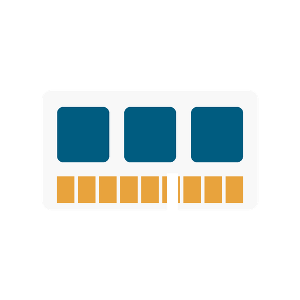
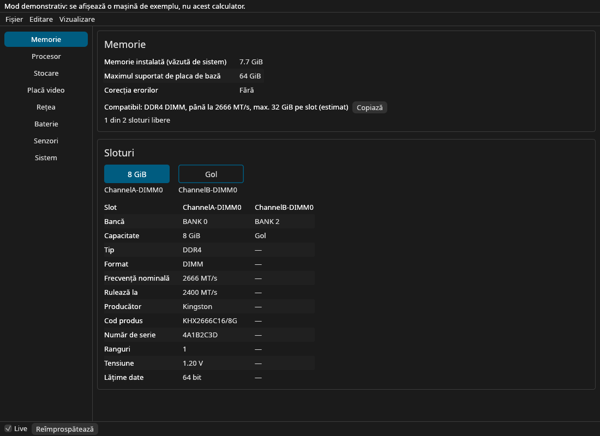
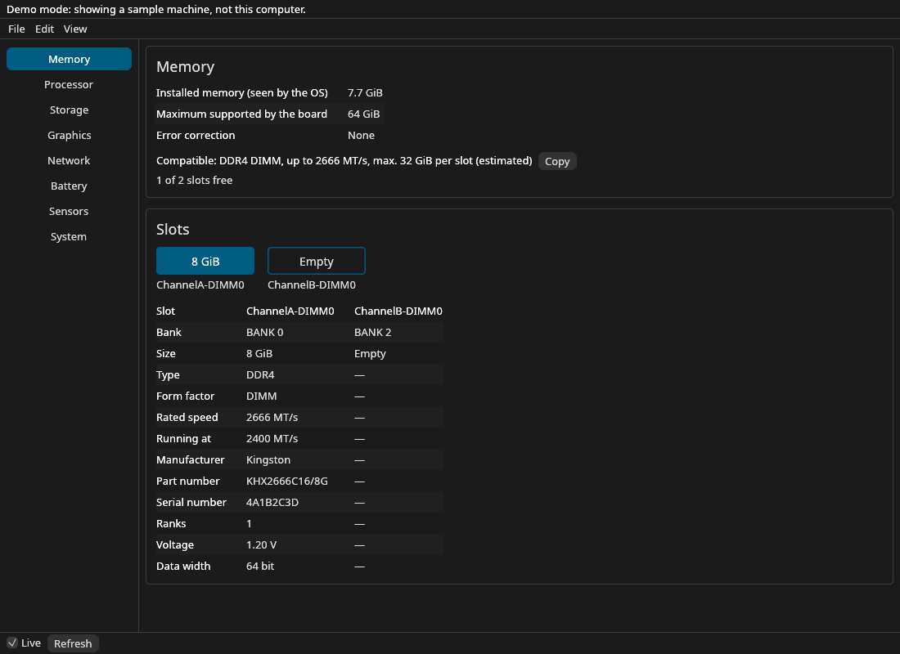
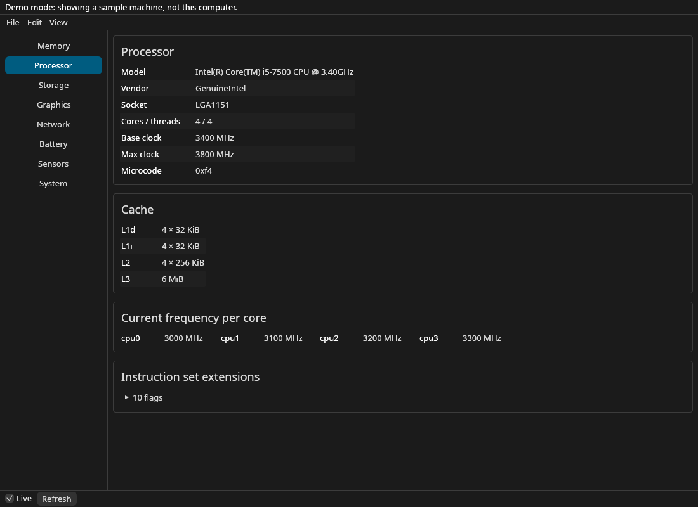
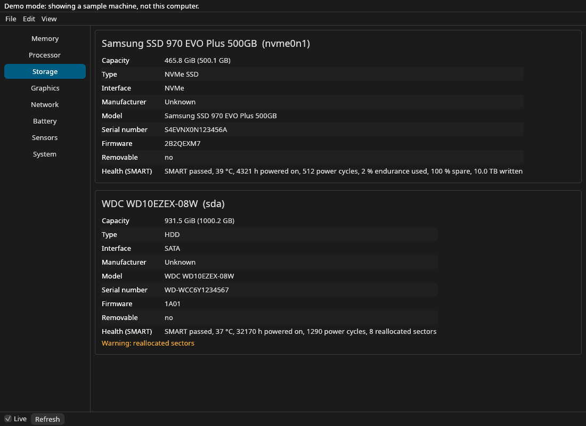
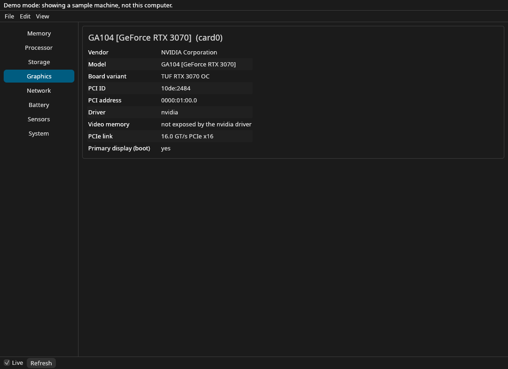
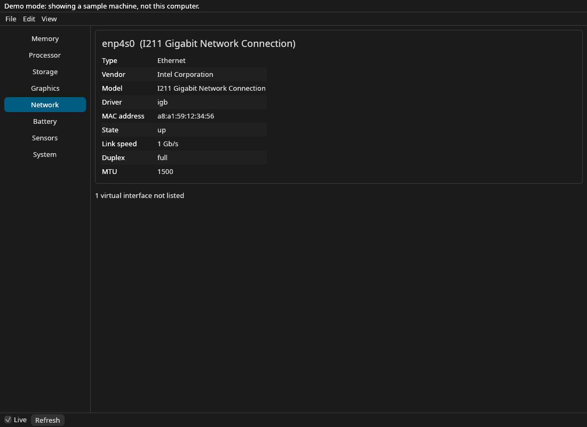
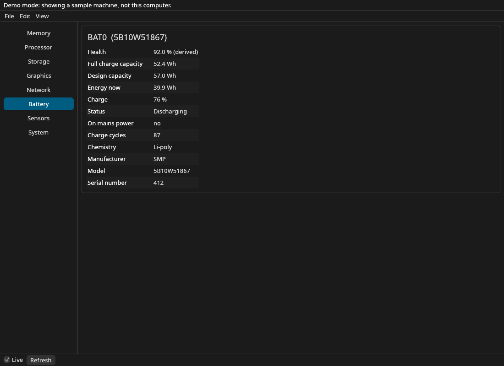
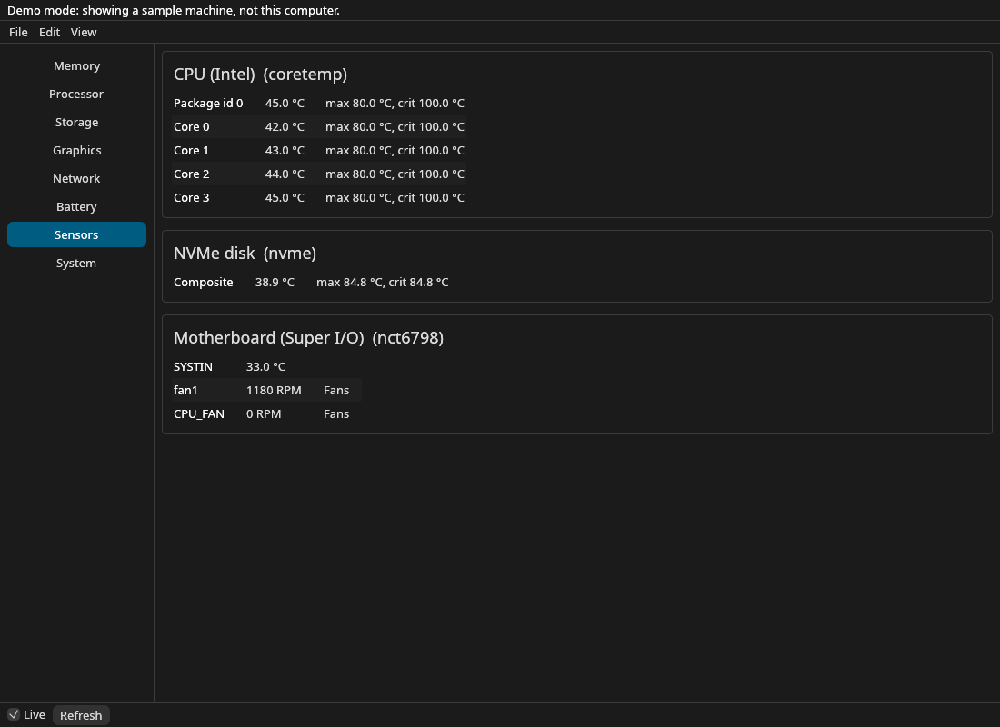

<div align="center">

<p align="center">
  
</p>


**O aplicație grafică pentru Linux și Windows care arată în detaliu configurația calculatorului: fiecare slot de RAM, procesorul, discurile cu sănătatea lor SMART, placa video, rețeaua, bateria și senzorii, fără terminal.**

[](https://github.com/nazdravan/rigscope/actions/workflows/ci.yml)
[](#licență)
[](Cargo.toml)
[](https://github.com/emilk/egui)
[](#linux)
[](#windows)

[Pornire rapidă](#pornire-rapidă) · [Memorie](#memorie) · [Procesor](#procesor) · [Stocare](#stocare-și-smart) · [Drepturi](#root-și-drepturi) · [Windows](#windows) · [Releases](../../releases) · [Issues](../../issues)

[English](README.md) · **Română**

</div>

<br />

Pe Linux detaliile sunt împrăștiate între `lshw`, `dmidecode`, `inxi`, `smartctl` și `/sys`, iar
cele mai multe scriu text brut. rigscope le adună într-o singură fereastră, în română sau
engleză, și răspunde la întrebarea cu care începe de obicei căutarea: *ce placă RAM pot cumpăra
pentru calculatorul ăsta?*



> **Notă: testat pe hardware real pe Windows, încă nu pe Linux.** Windows a rulat pe un laptop
> real (i7-4600U, Windows 10 22H2) pe 2026-11-05; valorile au coincis cu Task Manager și WMI.
> Varianta Linux a fost construită și testată în Docker (cu date hardware sintetice) și pe macOS:
> fereastra de parolă (`pkexec`), SMART pe discuri reale, clipboard-ul și dialogurile de fișiere
> trebuie încă verificate pe un calculator real cu Linux.

## Pornire rapidă

Încă nu există release: pachetele (AppImage, `.deb`, `.tar.gz` pentru Linux, un `.exe` portabil
pentru Windows) vin odată cu prima versiune. Până atunci, aplicația se construiește din surse.

### Din surse

```sh
# Rust de la https://rustup.rs, apoi:
git clone https://github.com/nazdravan/rigscope.git
cd rigscope
cargo run --release -p rigscope
```

Binarul ajunge în `target/release/rigscope`. Pe Linux, Windows și macOS citește calculatorul tău; în
rest deschide o mașină de exemplu, în mod demonstrativ. Opțiuni utile:

```sh
rigscope --lang ro                 # interfața în română
rigscope --section storage         # deschide direct o secțiune
rigscope --fixture fixtures/laptop-ddr5   # o mașină de exemplu în loc de aceasta
rigscope --capture-fixture DIR     # Windows, cu drepturi de administrator: salvează un fixture mascat al acestui calculator
```

Pachete opționale la rulare pe Linux: `pkexec` (polkit) pentru detaliile sloturilor și SMART,
`smartmontools` pentru sănătatea discurilor, `hwdata` (`pci.ids`) pentru numele plăcilor video
și de rețea.

---

## Ce arată

| Secțiune | Ce primești |
|---|---|
| **Memorie** | Fiecare slot: producător, cod produs, serial, capacitate, frecvența nominală și cea reală, ranguri, tensiune, lățime; sloturile goale; maximul plăcii; un rând de compatibilitate de lipit în căutarea unui magazin |
| **Procesor** | Model, socket(uri), nuclee / fire, frecvența de bază și maximă, frecvența live pe nucleu (pe Windows estimată ca % Processor Performance × frecvența de bază), cache L1–L3, microcod, extensii ale setului de instrucțiuni |
| **Stocare** | Discuri NVMe / SATA / USB / virtio (pe Windows din WMI, cu SMART pentru NVMe și SATA): model, capacitate (GiB și GB), SSD sau HDD, magistrală, firmware, serial, sănătate SMART cu avertismente |
| **Placă video** | Fiecare placă: producător, model și varianta plăcii (din `pci.ids`), driver, legătura PCIe, memoria video unde o expune driverul (pe Windows VRAM exact din DXGI, legătura PCIe și temperatura prin D3DKMT) |
| **Rețea** | Interfețele fizice: Ethernet sau Wi-Fi, numele adaptorului, driver, MAC, stare, viteză, duplex, MTU (cele virtuale sunt numărate, nu listate) |
| **Baterie** | Sănătate (capacitatea la încărcare completă față de cea de design, derivată), energia de acum, încărcare, cicluri, chimie, alimentare de la rețea |
| **Senzori** | Temperaturi cu limitele lor și turațiile ventilatoarelor din `hwmon`, actualizate la fiecare secundă. Pe Windows temperatura plăcii video (D3DKMT) și zonele termice ACPI, etichetate ca atare: nu sunt afișate niciodată drept temperatura procesorului |
| **Sistem** | Distribuție, kernel, nume calculator, timp de funcționare, placa de bază și BIOS |
| **Export** | Copiere sau salvare a unui raport text, salvare sau deschidere a unui snapshot JSON; serialele, adresele MAC și numele calculatorului sunt mascate implicit |

Valorile pe care hardware-ul nu le raportează apar ca *Necunoscut*, cele care cer root ca
*Necesită root*, iar valorile calculate sunt marcate *(estimat)* sau *(derivat)*: nimic nu e
ghicit.

## Memorie

Rândul de compatibilitate rezumă ce se potrivește: tipul și formatul, cea mai mare frecvență
nominală a plăcilor instalate, maximul plăcii împărțit la numărul de sloturi (*estimat*: SMBIOS nu
are o limită pe slot) și câte sloturi sunt libere. **Copiază** pune `DDR4 DIMM 2666 MT/s 32GB` în
clipboard. Tipurile de memorie amestecate și memoria lipită pe placă sunt semnalate, în loc să
dea un rând greșit.



## Procesor

Frecvența live pe nucleu (din cpufreq, sau din `/proc/cpuinfo` când cpufreq lipsește, marcată
ca atare), cache-uri grupate după mărime, ca procesoarele hibride P/E să le arate pe amândouă,
și numărul de socket-uri pe mașinile cu mai multe procesoare.



## Stocare și SMART

Discurile vin din `/sys/block`; magistrala se citește din calea dispozitivului, așa că stick-urile
USB și discurile virtuale nu sunt luate drept SATA. SMART cere root: **Citește cu drepturi
ridicate** rulează `smartctl --json -a` prin helperul privilegiat și arată verdictul,
temperatura, orele de funcționare, uzura și volumul scris la NVMe, sectoarele realocate / în
așteptare / necorectabile la ATA, cu avertismente.



<table>
<tr>
<td></td>
<td></td>
</tr>
<tr>
<td></td>
<td></td>
</tr>
</table>

## Scurtături de tastatură

<!-- shortcuts:start -->
| Scurtătură | Acțiune |
|---|---|
| `Ctrl+L` | Actualizare live |
| `Ctrl+O` | Deschide snapshot… |
| `Ctrl+S` | Salvează snapshot… |
| `Ctrl+Shift+C` | Copiază raportul |
| `Ctrl+Z` | Anulează |
| `F5` | Reîmprospătează |
<!-- shortcuts:end -->

---

## Root și drepturi

Fereastra nu rulează niciodată ca root. Tot ce poate citi un utilizator obișnuit se citește
direct; tabela de memorie din BIOS (`/sys/firmware/dmi/tables/DMI`) și SMART sunt accesibile doar
pentru root. Pentru ele, **Citește cu drepturi ridicate** pornește `pkexec /bin/sh -c <script>`:
o singură fereastră de parolă, iar scriptul, inclus în rigscope, doar afișează cele două fișiere
DMI și rulează `smartctl` dintr-o cale fixă de sistem, cu argumente fixe, pentru nume de discuri
validate. Niciun fișier al rigscope nu rulează ca root, deci nu e nimic de instalat și merge la
fel din AppImage, din `.tar.gz` sau din `.deb`. Scriptul nu interpretează nimic; fereastra
neprivilegiată interpretează rezultatul. Fereastra rămâne responsivă cât timp e deschis dialogul
de parolă.

Pe Windows toată aplicația rulează ca administrator (manifestul o cere la fiecare pornire), deci
nu există o citire ridicată separată.

## Decizii

- **Nimic ghicit.** Un BIOS care raportează prostii e afișat așa cum e; valorile lipsă spun de ce.
- **Maximul pe slot e o estimare.** SMBIOS dă doar totalul plăcii; rândul o spune.
- **Discurile USB, virtio și MMC nu primesc eticheta SSD/HDD**: indicatorul lor `rotational` nu e de încredere.
- **Interfețele de rețea virtuale sunt numărate, nu listate**, ca bridge-urile Docker să nu acopere placa de rețea.
- **Memoria video pentru driverul NVIDIA proprietar nu e afișată**: nu există în sysfs.

## Fișierul snapshot

**Fișier → Salvează snapshot** scrie JSON (`"schema": 1`, serialele mascate dacă nu alegi
altfel). **Deschide snapshot** arată un fișier salvat în locul acestui calculator; actualizarea
live se oprește până când **Reîmprospătează** revine la calculatorul curent. Sunt acceptate
fișiere de până la 4 MiB; fișierele mai vechi, fără secțiunile noi, se deschid în continuare.

## Linux

Are nevoie de un desktop cu X11 sau Wayland. Citește `/proc`, `/sys` și `/etc/os-release`;
opțional: polkit (`pkexec`), `smartmontools`, `hwdata`. Testat pe Debian 12 (Docker, Xvfb).
**Notă: încă nu a rulat pe un calculator real cu Linux.**

## Windows

După ce există un release, descarcă `rigscope-<versiune>-windows-x86_64.exe` din
[releases](../../releases). E portabil:
nu se instalează nimic, iar build-ul este x86_64 MSVC, cu CRT static. Minimul este Windows 10
1809; pe versiuni mai vechi legătura PCIe și temperatura plăcii video apar ca indisponibile.

- **Prompt UAC la fiecare pornire.** `.exe`-ul cere drepturi de administrator pentru că SMART și
  controlul complet al discurilor (IOCTL) le cer. Toată aplicația rulează ridicat (nu există
  helper separat).
- **SmartScreen avertizează** („Windows a protejat computerul”): `.exe`-ul nu e semnat. Se trece
  de avertisment cu **Mai multe informații** → **Rulați oricum**, iar suma se verifică cu
  `SHA256SUMS.txt` din release: `Get-FileHash rigscope-<versiune>-windows-x86_64.exe`.
- **Ce citește:** sloturile de memorie din tabela SMBIOS a firmware-ului (fără drepturi ridicate),
  topologia procesorului și cache-urile, o frecvență live estimată ca % Processor Performance ×
  frecvența de bază, discurile din WMI cu SMART pentru NVMe și SATA (și în spatele Intel
  RST/RAID, când controllerul lasă să treacă ATA SMART), placa video cu VRAM exact (DXGI),
  legătura PCIe și temperatura prin D3DKMT pe WDDM 2.4+, rețeaua și bateria. Zonele termice ACPI
  apar ca „ACPI thermal zone”, niciodată ca temperatura procesorului.
- **Ce nu se poate citi:** temperatura procesorului și ventilatoarele. Ambele necesită un driver
  de kernel, iar rigscope nu instalează drivere.
- **Testat pe hardware real** pe 2026-11-05: un laptop i7-4600U cu Windows 10 22H2. Memoria,
  nucleele / firele, cache-urile, discul, placa video, rețeaua și bateria au coincis cu Task
  Manager și WMI.

Pentru contribuitori: `rigscope --capture-fixture DIR` (Windows, cu drepturi de administrator) salvează un fixture
mascat al calculatorului, iar `--fixture DIR` deschide orice fel de fixture pe orice OS.
`.exe`-ul de release nu are fereastră de consolă, deci rezultatul capturii (reușita sau eroarea)
este în `DIR/capture.log`. Numele
din fixture nu conțin `:` (codat `%3A`), legăturile simbolice sunt în `links.txt`, iar
`.gitattributes` forțează LF.

## macOS și altele

**macOS** citește calculatorul prin `system_profiler` și `sysctl`: modulele de memorie (mărime,
tip, viteză, producător, număr de piesă), procesorul, modelul plăcii, sistemul de operare,
discurile SATA și NVMe cu verdictul SMART al unității, plăcile video și adaptoarele Ethernet și
Wi-Fi. Bateria și Senzorii nu se citesc încă pe macOS, iar discurile USB nu sunt listate. macOS
dă doar viteza la care rulează modulul (nu viteza nominală, tensiunea sau rank-urile), niciun
atribut SMART și nicio stare sau viteză a legăturii de rețea, iar Apple silicon nu are sloturi,
deci se vede doar totalul. Testat pe un iMac Intel (macOS 13);
varianta Apple silicon e acoperită doar de teste. `rigscope --capture-fixture DIR` salvează un
fixture mascat al Mac-ului.

Orice alt sistem se construiește și rulează pentru dezvoltare, în mod demonstrativ, cu o mașină de
exemplu.

---

## Structura codului

| Cale | Ce conține |
|---|---|
| `crates/rigscope-model` | Snapshot-ul: date + serde, rândul de compatibilitate, raportul text, mascarea |
| `crates/rigscope-smbios` | Decodor SMBIOS/DMI fără panici (tipurile 0, 2, 4, 16, 17) |
| `crates/rigscope-procfs` | Parsere pentru textul din `/proc` și `/sys`, căutare în `pci.ids` |
| `crates/rigscope-win`, `crates/rigscope-probe-win` | Windows: stratul FFI Win32 (unsafe; apelurile lui se compilează doar pe Windows) și colectorul construit pe el; ambele crate-uri se compilează și își rulează testele pe orice OS |
| `crates/rigscope-probe` | Construiește snapshot-ul dintr-o `Source` (fs real, director fixture, memorie); discuri, plăci video, rețea, baterie, senzori, JSON smartctl |
| `crates/rigscope-engine` | Sesiunea, registrul de comenzi, undo, protecția la panică |
| `crates/rigscope-ui` | Panourile egui, textele în engleză/română, tema |
| `apps/rigscope` | Binarul: fereastra, helperul privilegiat, canalul de control |
| `xtask` | `cargo xtask ci`, `linux`, `screenshot`, `shots`, `icons`, `banner`, `gen-fixtures`, `windows-icon` |
| `fixtures/` | Mașini de exemplu (desktop DDR4, laptop DDR5, VM, mașini Windows și macOS reale, mascate) folosite de teste și de modul demonstrativ |
| `assets/theme.toml` | Culorile, fontul și motivul pentru aplicație, iconițe și banner |
| `assets/icon.py`, `assets/banner.py` | Generează iconițele și acest banner (`cargo xtask icons`, `cargo xtask banner`) |

Capturile sunt făcute de aplicație: `cargo xtask shots` o rulează sub Xvfb în Docker și le
salvează în `docs/assets/`.

## Release

Încă nu există release. Primul release va publica din CI pachete Linux, o imagine de disc macOS și un `.exe` portabil pentru Windows.

## Teste

```sh
cargo xtask ci      # fmt, clippy -D warnings, teste, verificarea straturilor, verificarea wasm
cargo xtask linux   # clippy + teste într-un container Linux (Docker)
```

Parserele pentru date nesigure (SMBIOS, `/proc`, `/sys`, `pci.ids`, JSON smartctl, fișiere
snapshot, cereri de control) au teste de proprietăți; panourile au teste egui fără fereastră.

## Licență

Licențiat, la alegere, sub [Apache License, Version 2.0](LICENSE-APACHE) sau [licența MIT](LICENSE-MIT).
Noto Sans e sub SIL Open Font License ([assets/fonts/OFL.txt](assets/fonts/OFL.txt)).
